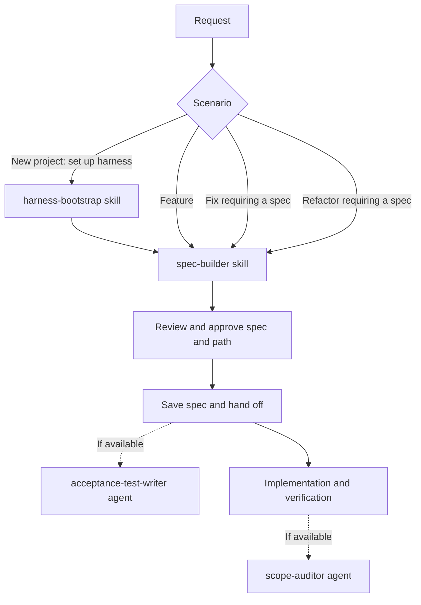

# Agent Foundry

Agent Foundry is an early-stage portable harness for coding agents. It combines
shared skills, project checks, trust decisions, and provider-specific adapters.

**Status:** Claude hooks have fixture coverage; Codex and Antigravity adapters
are experimental and have contract tests, not verified runtime integration. Do
not rely on these adapters as security boundaries. Read
[compatibility](docs/compatibility.md) and [security](docs/security.md).

## Skills

```sh
bin/foundry doctor
bin/foundry skills install codex  # or claude, antigravity
```

This only links skills. It does not enable hooks or change instructions,
permissions, or project trust. See [skills installation](docs/skills-install.md).

The core discovers checks in order: `.harness/check.sh`, `.claude/check.sh`,
`just check`, then `make check`. The Claude gate executes checks only for a
trusted Git project. Check and formatter commands are repository code, so trust
must be granted explicitly.

## Spec-driven workflow

Ask your coding agent to use `spec-builder` when you want a request defined
before implementation. The same workflow can describe a new project, feature,
fix, or refactor. These are suggested handoffs, not automatically invoked
agents or steps; availability depends on your agent environment.

For Agent Foundry's own development, [project instructions](AGENTS.md) define when a
spec is needed and how to complete the change. Other repositories choose whether to
adopt a spec workflow and can retain their existing conventions, including OpenSpec.



### What happens when a spec is created

1. The agent reads the request, relevant code and existing specs. If the project
   uses OpenSpec, it offers to use the project's OpenSpec change format.
2. It asks only questions the repository cannot answer, one at a time, until
   the acceptance criteria are testable.
3. It presents a draft with the goal, context, scope, exclusions, acceptance
   criteria, constraints, open questions and verification. Criteria have stable
   IDs and describe observable outcomes.
4. It proposes a path, normally `specs/<yyyy-mm-dd>-<slug>.md` or the project's
   existing spec location. The user approves both the draft and path before the
   file is written.
5. It hands off the approved spec as the reference for implementation. Map each
   criterion to automated or manual verification, update affected current docs,
   and report passed, failed, and unrun checks. A green project check does not by
   itself prove every criterion. Record results in the spec when useful or required.
   Implementation happens separately; optional agents can help with tests and review.

### Examples

The prompts below are messages to your coding agent after installing the skills;
they are not shell commands. Adapt the examples to your project.

**New project**

> Use `harness-bootstrap` to set up this new robot project, then use
> `spec-builder` to define its first feature: moving forward on command.

The bootstrap skill inventories the repository and proposes project
instructions and checks in phases, requesting approval before each next phase.
The spec can then define, for example: **AC-1:** Given the robot is stationary
and its path is clear, when it receives a forward command, then it moves forward.
Verification should describe how to test that behavior.

**Feature**

> Use `spec-builder` to specify obstacle detection for the robot, including
> how it reacts to an obstacle while moving. Do not implement it yet.

The draft defines scope and exclusions and can include: **AC-1:** Given the
robot is moving forward, when its sensor detects an obstacle within the agreed
stopping distance, then the robot stops before reaching the obstacle.

**Fix**

> Use `spec-builder` to specify a fix for the robot continuing to move after
> receiving a stop command. Include reproduction steps and a regression criterion.

The agent investigates the reported behavior and clarifies any missing
conditions. A criterion can state: **AC-1:** Given the robot is moving, when it
receives a stop command, then it stops within the agreed response time. The
verification section identifies a regression test or manual reproduction.

**Refactor**

> Use `spec-builder` to specify extracting motor control from the robot's command
> handler while preserving forward movement and stop behavior.

The draft sets the intended boundary, explicitly excludes behavior changes and
defines how existing behavior will be checked. For example: **AC-1:** Given the
robot is moving forward, when it receives a stop command, then its motors stop
within the existing response time.

## Agents

| Participant | Role in this workflow |
|---|---|
| [`harness-bootstrap`](skills/harness-bootstrap/SKILL.md) | A skill for setting up or auditing a repository's agent harness. It inventories the project, then proposes instructions, checks and applicable architecture sensors in approval-based phases. Use it when a project needs harness setup. |
| [`spec-builder`](skills/spec-builder/SKILL.md) | A skill that guides the coding agent through clarifying and drafting a testable spec. It asks for approval before saving the draft and does not implement the change. |
| [`acceptance-test-writer`](agents/acceptance-test-writer.md) | An optional agent definition for turning acceptance criteria into tests. |
| [`scope-auditor`](agents/scope-auditor.md) | An optional agent definition for reviewing completed work against its intent. |

The coding agent performs implementation and verification as a separate step.
Installing the skills links their instructions; it does not install the optional
agents or guarantee that any agent is invoked automatically. The included agent
definitions use Claude-specific tools and hooks and require a compatible setup;
the workflow also works without them.

### Continuing from a spec to delivery

Use [`delivery-workflow`](skills/delivery-workflow/SKILL.md) to coordinate an
approved spec through implementation, verification, and a durable implementation
journal. It supports products, features, and prototypes, with exploration, demo,
pilot, or production as separate maturity targets. Choose staged execution or
continuous execution within an explicitly authorized scope.

The workflow plans reuse of existing components and protected contracts, records
technical decisions and current implementation details, and ties delivery claims
to acceptance evidence. It also guides resumption, feedback-driven iterations, and
planning a demo's transition toward production. Existing SDD and OpenSpec workflows
remain available; spec-builder still hands off before implementation.

> Use delivery-workflow to prepare a booking demo using our existing authentication
> and catalog. Propose the spec and execution agreement, keep a decision journal,
> and identify which integrations will be simulated.

This is a skill with instructions and Markdown templates, not an executable
orchestrator, automatic agent installer, or security control. It does not grant
repository trust or publication permissions. See the
[workflow guide](docs/delivery-workflow.md) for the lifecycle and continuation examples.

## Testing

On macOS with Bash, Git, jq, Python 3, Perl, ShellCheck, and standard Unix tools:

```sh
tests/run.sh
```

The hook suite includes a real ShellCheck fixture; several other formatter
fixtures use shims and do not prove integration with real formatters. Tests do
not install hooks or modify existing agent configurations.

## Components

- `core/`: trust lookup, check discovery, gate state, event writing, and
  credential patterns.
- `hooks/`: inherited Claude-specific hooks and guard implementations.
- `skills/`: reusable workflows; some still have platform-specific details.
- `adapters/`: experimental Codex and Antigravity event translation.
- `instructions/`: an optional working agreement for review and merging.
- `tests/`: isolated tests and fixtures.

`install.sh` is disabled to prevent accidental use of the old incomplete
installer. The legacy script is retained in `legacy/` for reference only;
it can replace existing Claude configuration and must not be run as-is. This
snapshot does not contain the original global settings. See the
[inventory](INVENTORY.md) and adapter READMEs for details.
