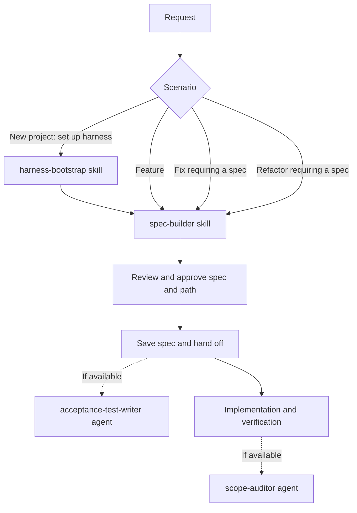
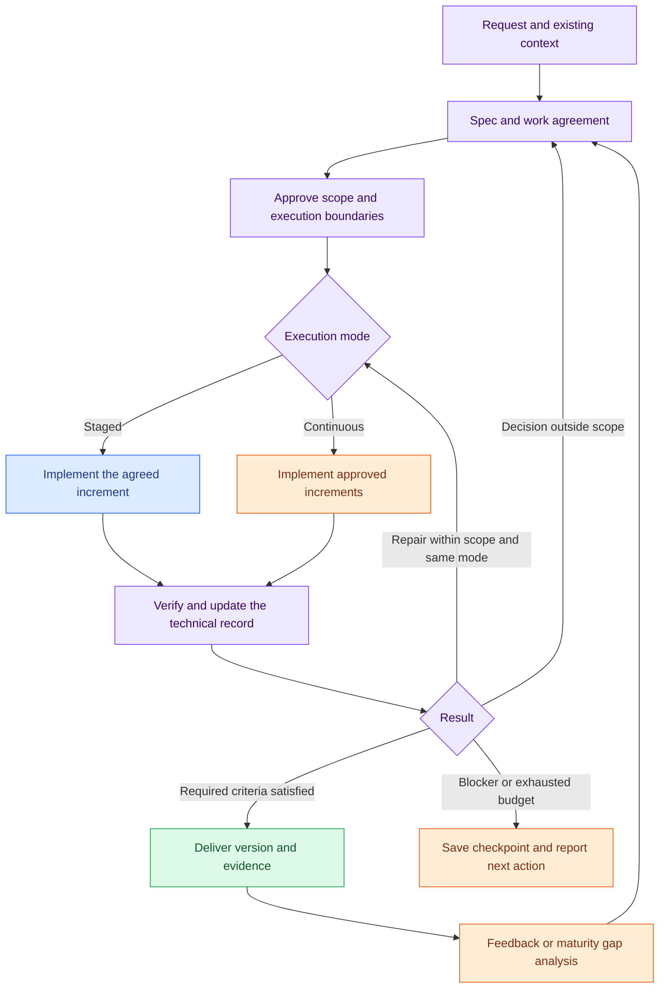

# Agent Foundry

Agent Foundry is an early-stage portable harness for coding agents. It combines
shared skills, project checks, trust decisions, and provider-specific adapters.

**Status:** Claude hooks have fixture coverage; Codex and Antigravity adapters
are experimental and have contract tests, not verified runtime integration. Do
not rely on these adapters as security boundaries. Read
[compatibility](docs/compatibility.md) and [security](docs/security.md).

## Skills

```sh
bin/foundry doctor
bin/foundry skills install codex  # or claude, antigravity
```

This only links skills. It does not enable hooks or change instructions,
permissions, or project trust. See [skills installation](docs/skills-install.md).

The core discovers checks in order: `.harness/check.sh`, `.claude/check.sh`,
`just check`, then `make check`. The Claude gate executes checks only for a
trusted Git project. Check and formatter commands are repository code, so trust
must be granted explicitly.

## Spec-driven workflow

Ask your coding agent to use `spec-builder` when you want a request defined
before implementation. The same workflow can describe a new project, feature,
fix, or refactor. These are suggested handoffs, not automatically invoked
agents or steps; availability depends on your agent environment.

For Agent Foundry's own development, [project instructions](AGENTS.md) define when a
spec is needed and how to complete the change. Other repositories choose whether to
adopt a spec workflow and can retain their existing conventions, including OpenSpec.



### What happens when a spec is created

1. The agent reads the request, relevant code and existing specs. If the project
   uses OpenSpec, it offers to use the project's OpenSpec change format.
2. It asks only questions the repository cannot answer, one at a time, until
   the acceptance criteria are testable.
3. It presents a draft with the goal, context, scope, exclusions, acceptance
   criteria, constraints, open questions and verification. Criteria have stable
   IDs and describe observable outcomes.
4. It proposes a path, normally `specs/<yyyy-mm-dd>-<slug>.md` or the project's
   existing spec location. The user approves both the draft and path before the
   file is written.
5. It hands off the approved spec as the reference for implementation. Map each
   criterion to automated or manual verification, update affected current docs,
   and report passed, failed, and unrun checks. A green project check does not by
   itself prove every criterion. Record results in the spec when useful or required.
   Implementation happens separately; optional agents can help with tests and review.

### Examples

The prompts below are messages to your coding agent after installing the skills;
they are not shell commands. Adapt the examples to your project.

**New project**

> Use `harness-bootstrap` to set up this new robot project, then use
> `spec-builder` to define its first feature: moving forward on command.

The bootstrap skill inventories the repository and proposes project
instructions and checks in phases, requesting approval before each next phase.
The spec can then define, for example: **AC-1:** Given the robot is stationary
and its path is clear, when it receives a forward command, then it moves forward.
Verification should describe how to test that behavior.

**Feature**

> Use `spec-builder` to specify obstacle detection for the robot, including
> how it reacts to an obstacle while moving. Do not implement it yet.

The draft defines scope and exclusions and can include: **AC-1:** Given the
robot is moving forward, when its sensor detects an obstacle within the agreed
stopping distance, then the robot stops before reaching the obstacle.

**Fix**

> Use `spec-builder` to specify a fix for the robot continuing to move after
> receiving a stop command. Include reproduction steps and a regression criterion.

The agent investigates the reported behavior and clarifies any missing
conditions. A criterion can state: **AC-1:** Given the robot is moving, when it
receives a stop command, then it stops within the agreed response time. The
verification section identifies a regression test or manual reproduction.

**Refactor**

> Use `spec-builder` to specify extracting motor control from the robot's command
> handler while preserving forward movement and stop behavior.

The draft sets the intended boundary, explicitly excludes behavior changes and
defines how existing behavior will be checked. For example: **AC-1:** Given the
robot is moving forward, when it receives a stop command, then its motors stop
within the existing response time.

## Delivery workflow: from a demo to production

Use [`delivery-workflow`](skills/delivery-workflow/SKILL.md) when you want the
coding agent to carry an approved spec through implementation and verification,
preserve technical decisions, and continue the same initiative across sessions
and deliveries. It can coordinate a new product, a feature in an existing product,
or an isolated prototype. A demo is an initial delivery that can evolve.

The skill extends the spec-driven development (SDD) workflow above. `spec-builder`
still defines the requirements and hands off before implementation;
`delivery-workflow` coordinates what happens next. Existing SDD handoffs and
project conventions, including OpenSpec, remain available.

### Choose the work, maturity, and execution mode

These choices are independent and are recorded in the work agreement:

| Choice | Options | Example |
| --- | --- | --- |
| Work type | Product, feature, prototype | A booking feature reusing the current catalog |
| Current and target maturity | Exploration, demo, pilot, production | An exploration becomes a client demo, then a ten-user pilot |
| Execution mode | Staged, continuous | Complete one agreed increment, or continue through the approved scope |

In **staged mode**, the agent completes the agreed increment and reports its
result. In **continuous mode**, it implements, verifies, repairs, and documents
successive increments within the approved scope. It reuses existing authorization
and consults you when a material decision falls outside it. Choosing a demo or
continuous mode does not grant additional permissions.

### How an initiative moves through the workflow

Purple is the shared SDD foundation, blue is the staged path, orange is continuous
execution and evolution, and green is a delivered version.



1. **Understand and agree.** Read the repository and any previous initiative
   record. Define the observable result, acceptance criteria, allowed simulations,
   protected components, and delivery conditions. Resolve material questions and
   record approval of the spec and execution boundaries before implementation.
2. **Plan reuse.** Identify components to reuse, extend, or create, with reasons
   and references. Define compatibility checks for protected contracts and
   preserve unrelated work. A branch or worktree alone does not prove compatibility.
3. **Implement and maintain the record.** Work in verifiable increments. Update
   consequential decisions, current technical documentation, evidence, and the
   checkpoint alongside the implementation. Correct in-scope failures; revisit
   the agreement before changes that exceed authorization.
4. **Deliver against evidence.** Report each criterion as passed, failed, or
   unverified, with its evidence and code reference. Include run or presentation
   instructions, simulations, limitations, and remaining work. Mandatory failed
   or unverified criteria keep the delivery incomplete.

Checks follow the active adapter's trust rules. If a blocker prevents progress,
the agent preserves a checkpoint and explains what is needed to continue. Unless
an explicit budget overrides it, two consecutive repair attempts for the same
failure without new evidence or measurable progress stop further repairs of that
failure. Independent authorized work may continue.

### What the agent keeps for the next iteration

The record separates the intended result, decision history, and current technical
state so another session can continue without reconstructing the original chat.

| Artifact | What it preserves |
| --- | --- |
| Spec and agreement | Requirements, stable criterion IDs, scope, approval, maturity, and execution limits |
| Decision journal | Technical choices, context, consequences, and links between replaced and current decisions |
| Current implementation documentation | Components, contracts, dependencies, data flow, run instructions, and real versus simulated integrations |
| Reuse plan | Existing components and callers, allowed changes, protected contracts, and compatibility checks |
| Verification record | Results tied to a code reference, evidence, skipped checks, and limitations |
| Current checkpoint | Completed, pending, or uncertain work; blockers; retry state; and the next authorized action |

Reuse the project's existing specs, ADRs, and technical docs. Where no convention
exists, the skill suggests `docs/initiatives/<initiative-id>/` for the initiative
record while keeping specs in the project's spec location. Small initiatives can
combine sections in a few files. Templates are optional starting structures;
the journal records consequential decisions rather than every action.

### Start, resume, iterate, and raise maturity

After installing the skills, send these as messages to your coding agent.

**Prepare a demo and its agreement**

> Use delivery-workflow to prepare a booking demo using our existing authentication
> and catalog. Use simulated availability and separate demo data. Propose the spec
> and execution agreement before implementation, including protected contracts.

**Authorize continuous execution after reviewing the proposal**

> Execute the approved booking spec continuously within its agreed limits. Keep
> the decision journal and current technical docs, verify the acceptance criteria,
> and deliver a locally runnable demo with presentation instructions.

**Resume an interrupted implementation**

> Resume the booking initiative from its checkpoint. Reconcile the record with
> current repository changes, preserve unrelated edits, and continue authorized work.

Resumption checks what actually happened before replaying an operation with an
unknown outcome. Relevant changes make prior evidence stale until reassessed;
completed work is not blindly repeated, and retry counts persist across sessions.

**Improve a presented demo**

> Turn this client feedback into the next booking increment. Classify defects,
> new requirements, and changed requirements; propose the updated scope and keep
> the prior delivery and criterion history identifiable.

**Plan a move to pilot or production**

> Evaluate moving the booking demo to a ten-user pilot with real availability.
> Identify what to retain, strengthen, replace, or retire, and propose the new
> criteria and verification plan. Keep unresolved target requirements explicit.

A transition plan reviews simulations, shortcuts, and operational needs against
the actual target context. It does not itself upgrade the initiative's maturity:
approved target criteria need supporting evidence. A demo may satisfy its own
spec while still requiring substantial work for production.

This version consists of portable skill instructions and Markdown templates.
The coding agent follows the process; there is no executable orchestrator or
background runner. Installation does not activate agents or hooks, grant trust,
or authorize publishing. Live provider integration and automated recovery remain
unverified. See the [detailed guide and eight change specs](docs/delivery-workflow.md)
and [manual validation scenarios](tests/delivery-workflow/scenarios.md).

## Agents

| Participant | Role in this workflow |
|---|---|
| [`harness-bootstrap`](skills/harness-bootstrap/SKILL.md) | A skill for setting up or auditing a repository's agent harness. It inventories the project, then proposes instructions, checks and applicable architecture sensors in approval-based phases. Use it when a project needs harness setup. |
| [`spec-builder`](skills/spec-builder/SKILL.md) | A skill that guides the coding agent through clarifying and drafting a testable spec. It asks for approval before saving the draft and does not implement the change. |
| [`delivery-workflow`](skills/delivery-workflow/SKILL.md) | A skill that coordinates approved implementation, technical records, evidence, resumption, iterations, and maturity transition planning. |
| [`acceptance-test-writer`](agents/acceptance-test-writer.md) | An optional agent definition for turning acceptance criteria into tests. |
| [`scope-auditor`](agents/scope-auditor.md) | An optional agent definition for reviewing completed work against its intent. |

The coding agent performs implementation and verification after specification,
optionally coordinated by `delivery-workflow`. One agent can perform the whole
workflow; multiple agents are used only when authorized and available. Installing
the skills links their instructions; it does not install the optional agents or
guarantee their invocation. The included agent definitions use Claude-specific
tools and hooks and require a compatible setup; the workflow also works without them.

## Testing

On macOS with Bash, Git, jq, Python 3, Perl, ShellCheck, and standard Unix tools:

```sh
tests/run.sh
```

The hook suite includes a real ShellCheck fixture; several other formatter
fixtures use shims and do not prove integration with real formatters. Tests do
not install hooks or modify existing agent configurations.

## Components

- `core/`: trust lookup, check discovery, gate state, event writing, and
  credential patterns.
- `hooks/`: inherited Claude-specific hooks and guard implementations.
- `skills/`: reusable workflows; some still have platform-specific details.
- `adapters/`: experimental Codex and Antigravity event translation.
- `instructions/`: an optional working agreement for review and merging.
- `tests/`: isolated tests and fixtures.

`install.sh` is disabled to prevent accidental use of the old incomplete
installer. The legacy script is retained in `legacy/` for reference only;
it can replace existing Claude configuration and must not be run as-is. This
snapshot does not contain the original global settings. See the
[inventory](INVENTORY.md) and adapter READMEs for details.
