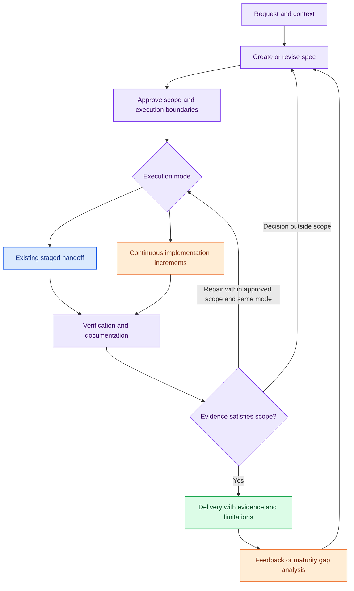

# Spec-driven delivery workflow

`delivery-workflow` extends the existing SDD handoff with an optional continuing
workflow. It supports new products, features in existing products, and isolated
prototypes. A demo can be improved over multiple deliveries and later evaluated
for a pilot or production use.

This first version consists of portable skill instructions and Markdown templates.
It is not an executable orchestrator, state validator, permission gate, or
background service. Following its process and maintaining its record remain the
coding agent's responsibility. No multiple-agent setup is required.

## Independent choices

| Choice | Values | Meaning |
| --- | --- | --- |
| Work type | Product, feature, prototype | What is being developed |
| Current and target maturity | Exploration, demo, pilot, production | Current evidence and the intended delivery context |
| Execution mode | Staged, continuous | Whether to complete one agreed increment or the approved scope |

An exploration may test an uncertain idea. A demo supports agreed presentation
scenarios, with simulations identified. A pilot supports a specified limited real
use. Production requirements depend on the product's actual users and operations.
These labels do not define universal quality guarantees or grant permissions.

## Relationship to the existing SDD flow

The existing flow remains request → spec-builder → approved spec and path →
implementation and verification as a separate step. The new skill is an optional
coordinator for that implementation, not an instruction for spec-builder to
implement changes. Existing project and OpenSpec conventions remain authoritative.

A repair stays within the agreed increment and execution mode. Scope approval and
repository trust are separate: checks still obey the active adapter's trust rules.

## What persists

Keep the approved spec as the source of requirements. Keep a journal for the
history of consequential decisions and current technical documentation for how
the implementation works now. A checkpoint identifies the current work state;
delivery evidence records what was actually verified against a code reference.

Reuse existing project artifacts. If the project lacks a convention, an initiative
can use `docs/initiatives/<id>/` with these sections in one or several files:

- Agreement: work type, current/target maturity, scope, approval, execution limits.
- Journal: decisions, consequences, supersession, and conditions for revisiting.
- Implementation: components, interfaces, dependencies, real/simulated integrations.
- Reuse plan: reuse/extend/create decisions, protected contracts, compatibility checks.
- Verification: stable criterion IDs, evidence, results, and unrun checks.
- State: code reference, completed/pending work, blockers, and next authorized action.

Iteration and promotion records are added when needed. These are not local trust
lists or event logs and must not contain credentials or sensitive customer data.
No fixed directory layout is imposed on consuming repositories.

## Examples

After installing the shared skills, ask the coding agent:

> Use delivery-workflow to build a booking demo in this product. Reuse existing
> authentication and the service catalog. Mock availability and isolate demo data.
> Present the spec and execution agreement before implementation.

Once that scope is approved:

> Execute the approved booking spec continuously within its agreed limits. Keep
> the implementation journal and verify the acceptance criteria. Deliver locally.

For subsequent work:

> Resume the booking initiative from its record. Reconcile repository changes
> before continuing; preserve unrelated edits.

> Turn this presentation feedback into the next booking increment. Preserve the
> delivered version and criterion history, and propose changes to the spec.

> Evaluate moving the booking demo to a ten-user pilot. Identify what to retain,
> strengthen, replace, or retire, and propose target criteria. Plan the transition.

Clear existing authorization is reused. A mode label never authorizes publishing,
deployment, destructive operations, protected-contract changes, or script execution
in an untrusted repository. Continuous execution stops at external blockers or the
agreed budget; by default it checkpoints after two consecutive repair attempts for
the same failure without new evidence or measurable progress.

## Installation and verification limits

The existing `bin/foundry skills install <platform>` discovers the new skill like
the others and links its whole directory, including references and templates.
See [skills installation](skills-install.md); installing a skill does not install
agents, hooks, permissions, or trust.

Manual scenario review and structural validation can assess this instruction-based
workflow. They do not prove live provider loading, autonomous execution, recovery,
or production readiness. See [compatibility](compatibility.md) and
[security](security.md) for the existing adapter limitations.

## Implementation slices

The eight change specs are independently reviewable. Their verification sections
distinguish manual instruction review from runtime checks.

| Slice | Spec | Skill reference |
| --- | --- | --- |
| 01 | [Work agreement](../specs/2026-11-10-work-agreement.md) | [Agreement](../skills/delivery-workflow/references/agreement.md) |
| 02 | [Implementation journal](../specs/2026-11-10-implementation-journal.md) | [Journal](../skills/delivery-workflow/references/journal.md) |
| 03 | [Component reuse](../specs/2026-11-10-component-reuse.md) | [Reuse](../skills/delivery-workflow/references/reuse.md) |
| 04 | [Delivery evidence](../specs/2026-11-10-delivery-evidence.md) | [Verification](../skills/delivery-workflow/references/verification.md) |
| 05 | [Continuous execution](../specs/2026-11-10-continuous-execution.md) | [Execution](../skills/delivery-workflow/references/execution.md) |
| 06 | [Resume execution](../specs/2026-11-10-resume-execution.md) | [Resume](../skills/delivery-workflow/references/resume.md) |
| 07 | [Demo iteration](../specs/2026-11-10-demo-iteration.md) | [Iteration](../skills/delivery-workflow/references/iteration.md) |
| 08 | [Maturity transition](../specs/2026-11-10-maturity-transition.md) | [Promotion](../skills/delivery-workflow/references/promotion.md) |

See [manual validation scenarios](../tests/delivery-workflow/scenarios.md) for
repeatable review inputs and the limits of the recorded walkthroughs.
